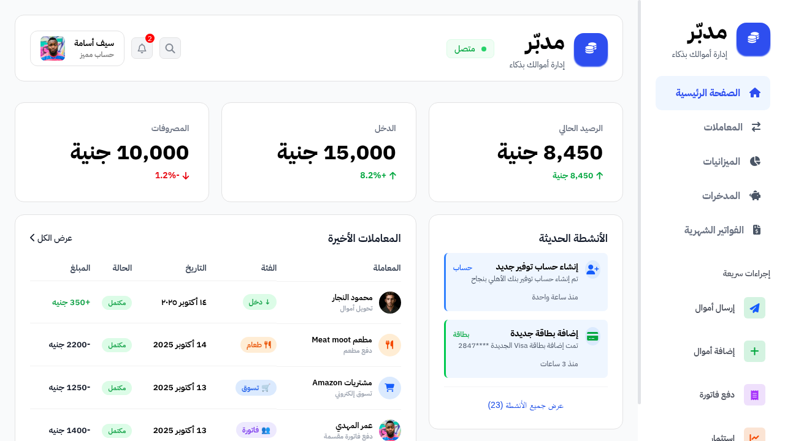

# Mudabbir (مدبّر) - Financial Dashboard

An Arabic personal finance dashboard UI that gives a quick overview of money in and money out: balance summary, income vs. expenses, recent transactions and quick actions.

**Live demo:** https://yosef-tamer206.github.io/Mudabbir---Financial-Dashboard/



## Features

- Summary cards for current balance, total income and total expenses (EGP)
- Income vs. expenses comparison chart
- Recent transactions list with categories
- Recent activity feed
- Quick actions for common operations
- Fully Arabic, right-to-left interface

## Tech Stack

- HTML5
- CSS3 (custom styling, responsive layout, pure CSS chart)
- Font Awesome icons

## Run Locally

No build step needed. Clone the repo and open `index.html` in a browser:

```bash
git clone https://github.com/Yosef-Tamer206/Mudabbir---Financial-Dashboard.git
cd Mudabbir---Financial-Dashboard
```

Then open `index.html`.

## Notes

- This is a front-end UI concept. The numbers shown are static sample data; there is no backend or data persistence.
